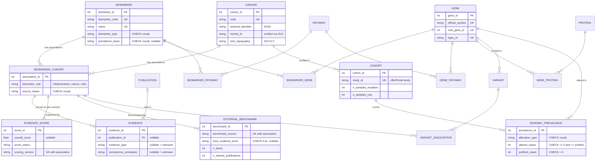

# CancerBioMap

**An integrated cancer biomarker database that measures how well each biomarker-cancer association is supported by
evidence, how common it is in tumours, and how far that judgement can be trusted.**

A full-stack biological database (PostgreSQL or SQLite, FastAPI, React) that integrates curated cancer biomarkers with
genes, proteins, pathways, variants, publications, TCGA tumour genomics and an external expert benchmark (CIViC).

> **Research and education only.** Scores summarise the evidence recorded in this database. They are not
> probabilities of clinical validity and say nothing about clinical approval, safety or effectiveness.

Version 1.1. What changed from 1.0, and why, is documented with evidence in [docs/UPGRADES.md](docs/UPGRADES.md).
A guided tour of the code is in [docs/PROJECT_GUIDE.md](docs/PROJECT_GUIDE.md); viva preparation is in
[docs/VIVA_QUESTIONS.md](docs/VIVA_QUESTIONS.md); curation procedures are in [docs/DATA_CURATION.md](docs/DATA_CURATION.md).

---

## Contents

1. [Abstract](#1-abstract)
2. [Problem statement](#2-problem-statement)
3. [Objectives](#3-objectives)
4. [Related resources](#4-related-resources)
5. [Contribution and novelty](#5-contribution-and-novelty)
6. [System architecture](#6-system-architecture)
7. [Technology stack](#7-technology-stack)
8. [Database design](#8-database-design)
9. [Data sources and integrity](#9-data-sources-and-integrity)
10. [Evidence-support score](#10-evidence-support-score)
11. [Evidence-gap analysis and curation priority](#11-evidence-gap-analysis-and-curation-priority)
12. [Genomic context: evidence versus prevalence](#12-genomic-context-evidence-versus-prevalence)
13. [Validation of the score](#13-validation-of-the-score)
14. [Installation and execution](#14-installation-and-execution)
15. [API](#15-api)
16. [SQL: views and report catalogue](#16-sql-views-and-report-catalogue)
17. [Testing](#17-testing)
18. [Project structure](#18-project-structure)
19. [Limitations and future work](#19-limitations-and-future-work)

---

## 1. Abstract

Cancer biomarker knowledge is scattered across gene and protein databases, pathway maps, genomic consortia and the
literature, and most resources state that a biomarker is associated with a cancer without saying how well that
association is supported. CancerBioMap integrates 47 curated biomarkers, 4 cancer types, 43 genes, 40 proteins,
14 KEGG pathways, 12 variants and 86 verified PubMed publications in a normalised relational schema of 18 tables and
2 views. For each of 58 biomarker-cancer-role associations it computes an explainable, missing-data-aware
evidence-support score and an evidence-gap profile, places the association against its alteration frequency in
5 TCGA PanCancer Atlas cohorts, and ranks gaps into a prevalence-weighted curation work list. The score is validated
externally against CIViC expert evidence levels (Spearman rho 0.47, permutation p = 0.006, n = 34) and internally for
robustness to its weights (mean rank correlation 0.91 over 1,000 random weightings). Every reference identifier was
verified against the official API of its source.

## 2. Problem statement

1. Biomarker information is fragmented across heterogeneous resources with different identifiers.
2. Users can see which biomarkers are linked to a cancer, but rarely what evidence supports each link, how diverse it
   is, or whether it conflicts.
3. Simple counts hide uncertainty: a biomarker with no recorded evidence looks the same as one with evidence against
   it unless missing data is modelled explicitly.
4. Leading knowledge bases centre on DNA variants; serum, protein and methylation markers are under-represented.
5. Curators need to know where evidence is thin, and which of those gaps matter most.

## 3. Objectives

* A normalised (3NF) relational schema for biomarkers, cancers, genes, proteins, variants, pathways, publications,
  associations, evidence, scores, tumour cohorts, alteration counts and external benchmarks, with full referential
  integrity and SQL views for derived data.
* A validated, idempotent import pipeline for curated CSVs, plus scripts that verify or fetch data from public APIs.
* REST APIs and a research dashboard for search, filtering, navigation, analytics and CSV export.
* An evidence-aware, decomposable, monotone score with explicit missing-data handling, and an evidence-gap analysis.
* Integration of population-level tumour genomics (TCGA) with literature evidence.
* Validation of the score against an independent expert benchmark and for sensitivity to its parameters.
* Verified portability between SQLite and PostgreSQL.

## 4. Related resources

| Resource | What it provides | Relation to this project |
|---|---|---|
| CIViC | Community-curated clinical interpretations of cancer variants with evidence levels A-E | Used as the external benchmark for validation (never as a score input). Variant-centred: in our data it covers 17/20 mutation associations and 0/4 serum-protein associations |
| OncoKB | Expert-curated therapeutic levels of evidence | Categorical expert levels; licensed for commercial use |
| COSMIC | Catalogue of somatic mutations | Mutation frequencies, not role-specific evidence |
| cBioPortal | Exploration of cancer genomics datasets including TCGA | Source of the TCGA alteration counts used here |
| DisGeNET | Gene-disease associations with a GDA score built from source and publication counts | Closest prior art for an evidence score; not role-specific, no explicit unknown state, no prevalence link |
| MarkerDB | Clinical and pre-clinical molecular biomarkers | Broad catalogue; evidence coverage scoring is not its focus |
| ClinVar | Variant-condition assertions with review status | Germline/somatic interpretation; review stars reflect submitter review |
| Cancer Genome Interpreter | Annotation of tumour alterations, including drug-response biomarkers | Tool-oriented; associations are not scored for evidence coverage |

## 5. Contribution and novelty

CancerBioMap does not claim a new biological finding or a clinically validated score. Its contributions are:

1. **Role-specific, decomposable, missing-data-aware evidence score.** Each biomarker-cancer association is stored and
   scored per role (HER2 / breast / predictive is separate from HER2 / breast / prognostic). Four inspectable
   components; unknown is never treated as zero; provisional and insufficient states. Unlike a count-based score
   (for example DisGeNET's GDA score), it is role-specific, separates unknown from absent, and is provably monotone:
   adding supporting evidence never lowers it (tested on randomised cases).
2. **Evidence versus prevalence.** Literature support is set against how common the defining alteration is in tumours
   (TCGA, raw counts, Wilson intervals), which identifies common alterations with thin evidence.
3. **Prevalence-weighted curation priority.** Gap flags with severities, including a role-evidence mismatch check,
   become a ranked work list. In this release the list was used to curate two pivotal trials, which cleared their
   flags and raised agreement with the external benchmark.
4. **Validated, not just asserted.** Rank concordance with CIViC, a Monte Carlo weight-robustness analysis with
   component ablation, and a versioned audit of every score change.

## 6. System architecture

```mermaid
flowchart LR
    subgraph Sources[Public sources]
      PM[PubMed E-utilities]
      NG[NCBI Gene / HGNC]
      UP[UniProt REST]
      KG[KEGG REST]
      CB[cBioPortal API<br/>TCGA PanCancer Atlas]
      CV[CIViC GraphQL]
      OL[EBI OLS<br/>Mondo, DOID]
      EN[Ensembl REST]
    end
    CSV[(Curated CSVs<br/>data/sample)]
    Sources -- verify and fetch<br/>scripts/*.py --> CSV
    CSV -- validated import<br/>services/importer.py --> DB[(PostgreSQL / SQLite<br/>18 tables + 2 views)]
    DB --> SVC[FastAPI services<br/>queries, scoring, gaps, prevalence,<br/>validation, robustness, analytics]
    SVC --> API[REST API + OpenAPI /docs]
    API -- /api proxy --> UI[React + TypeScript dashboard]
```



Layers: data (SQLAlchemy models, Alembic migrations, SQL views), services (pure scoring and robustness modules plus
database services), API (FastAPI routers with validated parameters and structured errors), presentation (React).

## 7. Technology stack

| Layer | Technology | Why |
|---|---|---|
| Database | PostgreSQL (verified on 16), SQLite for zero-setup development | CHECK/UNIQUE/FK constraints, views; identical results on both |
| ORM and migrations | SQLAlchemy 2, Alembic | Typed mappings, bound parameters, versioned and reversible schema changes |
| API | FastAPI, Pydantic v2 | Declarative validation, automatic OpenAPI documentation |
| Data processing | Python, pandas | CSV validation and the curation scripts |
| Frontend | React 18, TypeScript (strict), Vite, Tailwind CSS 4, Recharts | Typed components, accessible charts with table views |
| Testing | Pytest, FastAPI TestClient, Vitest, Testing Library | 80 backend and 15 frontend tests |

## 8. Database design

### ER diagram



Unchanged entities (protein, pathway, variant, publication and the junction tables) are as in the full DDL:
[backend/sql/schema_postgresql.sql](backend/sql/schema_postgresql.sql), generated from the migrations.

### Design decisions

* **1NF**: atomic attributes; multi-valued facts live in junction tables (CSV `;` lists are split by the importer).
* **2NF/3NF**: no partial or transitive dependencies; publication metadata lives once in `publication`; cohort
  descriptors live once in `cohort`.
* **Counts, not percentages**: `genomic_prevalence` stores altered and profiled counts. Frequencies are derived in
  the view `v_tcga_frequency`, which pools a cancer's cohorts by summing counts (averaging percentages would be wrong
  when cohorts differ in size).
* **Association per role**: `UNIQUE(biomarker_id, cancer_id, biomarker_role)`.
* **Missing data**: nullable evidence type, consistency and score components mean unknown.
* **Integrity**: CHECK constraints on every vocabulary, year range, count relationship and score range; FK actions
  chosen per relationship (CASCADE for dependent rows, RESTRICT for referenced master data, SET NULL for a removed
  publication).
* **Versioned scores**: `UNIQUE(association_id, scoring_version)`; version 1.0.0 remains reproducible.
* **Deterministic ordering**: every ORDER BY ends with a unique, collation-independent key, so SQLite and PostgreSQL
  return identical results.

## 9. Data sources and integrity

| Source | Used for | Verification |
|---|---|---|
| PubMed (NCBI E-utilities) | Publication metadata | 86/86 PMIDs match on title and year (`scripts/fetch_pubmed.py`) |
| NCBI Gene, HGNC | Gene IDs, symbols, HGNC IDs | 43/43 genes; each HGNC ID checked against the NCBI Gene ID |
| UniProt | Protein accessions | 40/40 reviewed human entries for the stated gene |
| KEGG | Pathway membership | 14/14 pathways match `/link/hsa` (free for academic use) |
| Ensembl REST | Variant coordinates | 8/8 dbSNP IDs at the stated GRCh38 position |
| Disease Ontology, Mondo (EBI OLS), WHO ICD-O-3 | Cancer identifiers | 4/4 Mondo IDs exist, are current and cross-reference the stored DOID |
| cBioPortal (TCGA PanCancer Atlas) | Alteration counts | 645 rows for 43 genes x 5 cohorts x 3 alteration types; spot-checked against the TCGA marker papers |
| CIViC (CC0) | External benchmark only | 34 of 58 associations matched; matching rules recorded per row |

No PMIDs or citations were invented; metadata comes from PubMed, not memory. Evidence summaries paraphrase each
paper's main finding. Consistency annotations are curator judgements (`supports`, `mixed`, `conflicting`, or blank
for unknown). KEGG rows are context-only database annotations. One association (CA 15-3 / breast / monitoring) is
deliberately recorded without evidence to demonstrate the insufficient state. No synthetic records are present.

## 10. Evidence-support score

```
Score = 0.35 P + 0.25 D + 0.25 T + 0.15 C        (each component 0-100; weights configurable, must sum to 1)
```

| Component | Definition (n = distinct count) |
|---|---|
| P Publication support | `100 log2(1+n) / log2(1+cap)`, cap 5: diminishing returns |
| D Source diversity | `100 (1 - 0.5^n)` over distinct supporting sources; context-only records are excluded |
| T Evidence type | `100 (1 - (1 - b1) prod_{i>=2} (1 - lambda b_i))`, b = rubric/100 over distinct designs, lambda 0.25 |
| C Consistency | `100 (supports + 0.5 mixed) / annotated` |

Rubric: meta-analysis 100, randomised clinical trial 95, clinical guideline 90, clinical trial 85, patient cohort 80,
genomic profiling 65, experimental 55, review 40, computational prediction 20. Weights and rubric are proposed
project parameters, not validated clinical standards; section 13 measures how much they matter.

Properties (all tested): a single design scores its rubric value; T lies between the strongest design and 100;
adding a design never lowers T; adding a supporting record never lowers the overall score; duplicates never inflate
it; the function is pure and deterministic.

Missing data: a component with no observable input is NULL (unknown). All four observed gives a complete score;
observed weight of at least 50% gives a provisional score renormalised over observed weights; otherwise insufficient
(no score). Current data: 55 complete, 2 provisional, 1 insufficient.

Worked example (unit-tested): three publications (RCT, cohort, genomic profiling), two sources, two "supports":
P = 77.37, D = 75, T = 96.65, C = 100, score = 84.99 (version 1.0.0 gave 83.45).

## 11. Evidence-gap analysis and curation priority

Flags and severities: no evidence (5), role-evidence mismatch (4), inconsistent (3), few publications (2), single
source (2), low score (2), untyped evidence (1), no consistency annotation (1), incomplete metadata (1).

Role-evidence mismatch checks whether any recorded study design is of a kind the claimed role needs: predictive
needs interventional evidence or a guideline; prognostic, risk and monitoring need patient outcome data; diagnostic
additionally accepts tumour genomic profiling.

`curation priority = gap severity x (1 + 4 x min(TCGA frequency, 0.5))`.

Gaps describe this database's records only; absence here is not absence in the literature.

## 12. Genomic context: evidence versus prevalence

For 16 single-gene biomarkers whose definition matches a gene-level alteration (`biomarker.prevalence_basis`), the
database reports the TCGA frequency of that alteration in the association's cancer, with a 95% Wilson interval.
Variant-specific biomarkers are marked as upper bounds. Protein, RNA, germline, fusion, signature and
acquired-resistance biomarkers are deliberately excluded.

The Evidence vs Prevalence page plots frequency against score. With thresholds 75 and 10%: 2 established, 7 common
but thinly supported, 1 rare but well supported, 13 rare and thinly supported.

## 13. Validation of the score

* **External (CIViC)**: Spearman rho 0.47 between the score and the best CIViC level (permutation p = 0.006;
  bootstrap 95% CI 0.17 to 0.70; n = 34). Mean score A 72.5, B 66.9, C 61.7.
* **Coverage**: CIViC covers 0 of 4 serum-protein, 0 of 2 methylation and 0 of 3 genomic-signature associations.
* **Robustness**: mean Spearman 0.91 between the baseline ranking and rankings under 1,000 random weightings;
  78% of the top 10 retained. Ablation: source diversity and consistency carry little ranking information in the
  current data.
* **Version audit**: every association scored with 1.0.0 and 1.1.0, with the reason for each change.

Details, including why version 1.0.0 had a slightly (not significantly) higher CIViC correlation, are in
[docs/UPGRADES.md](docs/UPGRADES.md).

## 14. Installation and execution

Prerequisites: Python 3.11+ (tested on 3.13), Node.js 18+ (tested on 24). PostgreSQL 14+ optional (tested on 16).

### Backend

```bash
cd backend
python -m venv .venv
source .venv/bin/activate              # Windows: .venv\Scripts\activate
pip install -r requirements.txt
cp .env.example .env                   # SQLite by default
python -m scripts.init_db              # migrate + import sample data + compute scores
uvicorn app.main:app --reload --port 8000
```

API: <http://127.0.0.1:8000/api>, Swagger UI: <http://127.0.0.1:8000/docs>.

### Frontend

```bash
cd frontend
npm install
npm run dev                            # http://localhost:5173 (proxies /api to port 8000)
```

### PostgreSQL

```sql
CREATE ROLE cancerbiomap LOGIN PASSWORD '<choose-a-password>';
CREATE DATABASE cancerbiomap OWNER cancerbiomap;
```

Set `DATABASE_URL=postgresql+psycopg://cancerbiomap:<password>@localhost:5432/cancerbiomap` in `backend/.env` and run
`python -m scripts.init_db`. On macOS with Homebrew, start the server with `LC_ALL` set (for example
`LC_ALL=en_US.UTF-8 pg_ctl ... start`), otherwise PostgreSQL refuses to start.

### Optional write protection

Set `ADMIN_TOKEN` in `backend/.env` to require the `X-Admin-Token` header for real imports and score recomputation.

### Reset

```bash
python -m scripts.init_db --reset      # SQLite only: recreate the database file
```

## 15. API

Interactive documentation at `/docs`. Main endpoints:

| Method | Path | Purpose |
|---|---|---|
| GET | `/api/dashboard/stats` | Dashboard statistics |
| GET | `/api/biomarkers`, `/api/biomarkers/{id}` | Search, filter, sort, paginate; detail with evidence, scores, TCGA frequency, CIViC level |
| GET | `/api/cancers`, `/api/cancers/{id}`, `/api/cancers/compare` | Cancer list, detail (cohorts, most altered genes), comparison |
| GET | `/api/genes`, `/api/proteins`, `/api/pathways`, `/api/variants` | Entity browsing; gene detail includes TCGA frequencies |
| GET | `/api/publications` | Research evidence |
| GET | `/api/associations`, `/api/associations/{id}` | Association, evidence, live score explanation, 1.0.0 score, gaps |
| GET | `/api/scores/methodology`, `/api/scores/comparison`, `/api/scores/robustness` | Method; version audit; weight robustness |
| GET | `/api/validation/civic` | Concordance with CIViC |
| GET | `/api/prevalence/discordance`, `/api/cohorts` | Evidence versus prevalence; TCGA cohorts |
| GET | `/api/gaps` | Gap analysis with severity and curation priority |
| GET | `/api/analytics/catalogue`, `/api/analytics/{report}` | SQL report catalogue and execution |
| GET | `/api/network` | Relationship graph built from database links |
| GET | `/api/export/{dataset}` | CSV export |
| POST | `/api/import/{entity}`, `/api/scores/recompute` | Validated CSV import (dry run by default); recompute (token if configured) |

Errors use `{"error": {"code", "message", "details"}}` with status 400, 401, 404, 422 or 500. Internal exceptions and
SQL are never returned.

## 16. SQL: views and report catalogue

Views (`app/views.py`, migration 0003): `v_tcga_frequency` (pooled frequency per gene, cancer and alteration type)
and `v_association_prevalence` (each association with the frequency of its defining alteration). Twelve documented,
parameterised reports run from the SQL Analytics page; all are listed with their SQL in
[backend/sql/query_catalogue.sql](backend/sql/query_catalogue.sql). Example:

```sql
-- Common alterations with thin recorded evidence (curation priority)
SELECT ap.biomarker, ap.cancer, ap.biomarker_role, ap.official_symbol,
       100 * ap.frequency AS percent_altered, s.overall_score, s.score_status
FROM v_association_prevalence ap
JOIN evidence_score s ON s.association_id = ap.association_id AND s.scoring_version = :scoring_version
WHERE ap.frequency >= :min_frequency AND (s.overall_score IS NULL OR s.overall_score < :max_score)
ORDER BY ap.frequency DESC, ap.association_id;
```

Rounding is done in Python, not SQL, because PostgreSQL has no `ROUND(double precision, int)`.

## 17. Testing

```bash
cd backend  && python -m pytest -q        # 80 tests
cd frontend && npm test                   # 15 tests
```

| Area | Examples of what is tested |
|---|---|
| Scoring | Hand-calculated cases; provisional and insufficient states; duplicates; determinism; randomised monotonicity and bounds; the frozen 1.0.0 results; the KEGG correction |
| Schema and migrations | FK, UNIQUE and CHECK enforcement; cascades; migrations up, down and up again including views; model-migration equality |
| Import | Sample counts; idempotent re-import; row-numbered errors; atomic rollback; ontology ID formats; prevalence count rules; prevalence basis needs one gene |
| API | Search, filters, pagination, details, gaps v2 and the curation loop, prevalence pooling versus the SQL view, robustness determinism, CIViC statistics, version comparison, new reports, write guard, error format |
| Frontend | Unknown rendered as unknown; provisional warning; network layout; frequency formatting; upper-bound marking; CIViC badge; quadrant grouping; accessible rank intervals |

Portability: every read endpoint (190 requests) returns identical JSON on SQLite and PostgreSQL 16.

## 18. Project structure

```
backend/
  app/          config, database, models, vocab, views, security, scoring (pure), scoring_legacy (frozen 1.0.0),
                robustness (pure), main
    routers/    catalog (browse/search), evidence (scores, gaps, analytics, import/export), analysis (1.1 features)
    services/   queries, scores, gaps, prevalence, validation, analytics (SQL catalogue), importer
  alembic/      0001 initial schema, 0002 genomic context and ontologies, 0003 views
  data/sample/  curated and fetched CSVs
  scripts/      init_db, fetch_pubmed, verify_sources, fetch_ontologies, fetch_prevalence, fetch_civic, export_sql
  sql/          schema_postgresql.sql, query_catalogue.sql (both generated)
  tests/        pytest suite
frontend/src/
  api/          typed client and response types
  components/   layout, UI kit, charts, score breakdown, network graph, evidence list, genomic badges
  pages/        dashboard, explorers, details, gaps, evidence vs prevalence, score validation, analytics, methodology,
                import, about
docs/           UPGRADES.md, PROJECT_GUIDE.md, VIVA_QUESTIONS.md, DATA_CURATION.md
```

## 19. Limitations and future work

Limitations: 47 biomarkers and 4 cancers selected for teaching; landmark positive studies dominate, so source
diversity and consistency carry little information; weights and rubric are proposed parameters (their influence is
measured, not calibrated); single-curator annotations; CIViC matching at gene or curated-keyword level; TCGA
frequencies are cohort-wide and gene-level.

Future work: ingest CIViC and ClinVar evidence as independent sources (with care to keep a held-out benchmark);
curate negative and mixed evidence deliberately; subtype-aware and variant-level frequencies; multi-curator
annotation with inter-annotator agreement; therapy linkage from FDA labels; authentication with curator roles.
